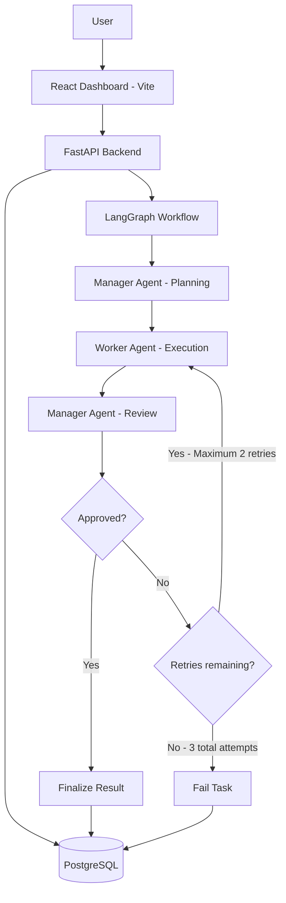

# AI Workforce – Multi-Agent Task Orchestration Platform

AI Workforce is a multi-agent task orchestration platform that uses AI agents to plan, execute, and review user-submitted tasks through a structured workflow.

Instead of relying on a single AI assistant, the platform separates responsibilities between a Manager Agent and a Worker Agent. The workflow is coordinated using LangGraph.

## Architecture



## Agent Responsibilities

### 1. Manager Agent

- Understands the submitted task.
- Generates an execution plan.
- Defines worker responsibilities.
- Establishes acceptance criteria.
- Reviews the Worker Agent's output.
- Approves the result or requests another attempt.

### 2. Worker Agent

- Receives the execution plan and assignment.
- Executes the requested task.
- Generates the deliverable.
- Uses review feedback when another attempt is required.

### 3. LangGraph Workflow

LangGraph coordinates the complete workflow:

1. Manager planning.
2. Worker execution.
3. Manager review.
4. Conditional approval or retry.
5. Finalization or failure.

The workflow allows a maximum of two retries, giving each task up to three execution attempts.

## Technology Stack

| Component | Technology |
|---|---|
| Frontend | React.js, Vite |
| Backend | Python, FastAPI |
| AI model | Google Gemini |
| Agent orchestration | LangGraph |
| Database | PostgreSQL |
| ORM | SQLAlchemy |
| API validation | Pydantic |

## Features Implemented

- Task submission through a web dashboard.
- AI-powered task planning.
- Manager-to-Worker task delegation.
- Automated output review.
- Conditional retry mechanism.
- Maximum retry limit.
- Task status monitoring.
- Agent activity timeline.
- Persistent task and activity records.
- Final output display with Markdown rendering.
- Execution history.

## Project Structure

```text
ai-workforce/
│
├── backend/
│   ├── app/
│   │   ├── agents/
│   │   │   ├── manager.py
│   │   │   └── worker.py
│   │   ├── api/
│   │   │   └── tasks.py
│   │   ├── database/
│   │   ├── graph/
│   │   │   ├── nodes.py
│   │   │   ├── state.py
│   │   │   └── workflow.py
│   │   ├── models/
│   │   ├── services/
│   │   └── main.py
│   ├── tests/
│   │   └── test_workflow.py
│   ├── requirements.txt
│   └── .env.example
│
├── frontend/
│   ├── src/
│   │   ├── App.jsx
│   │   ├── App.css
│   │   └── main.jsx
│   ├── package.json
│   └── vite.config.js
│
├── .gitignore
└── README.md
```

## Getting Started

### Prerequisites

- Python 3.12 or compatible version.
- Node.js and npm.
- PostgreSQL.
- Google Gemini API key.

### 1. Clone the repository

```bash
git clone https://github.com/rrd2001-ai/ai-workforce.git

cd ai-workforce
```

### 2. Configure the backend

```bash
cd backend

python -m venv venv

source venv/bin/activate

pip install -r requirements